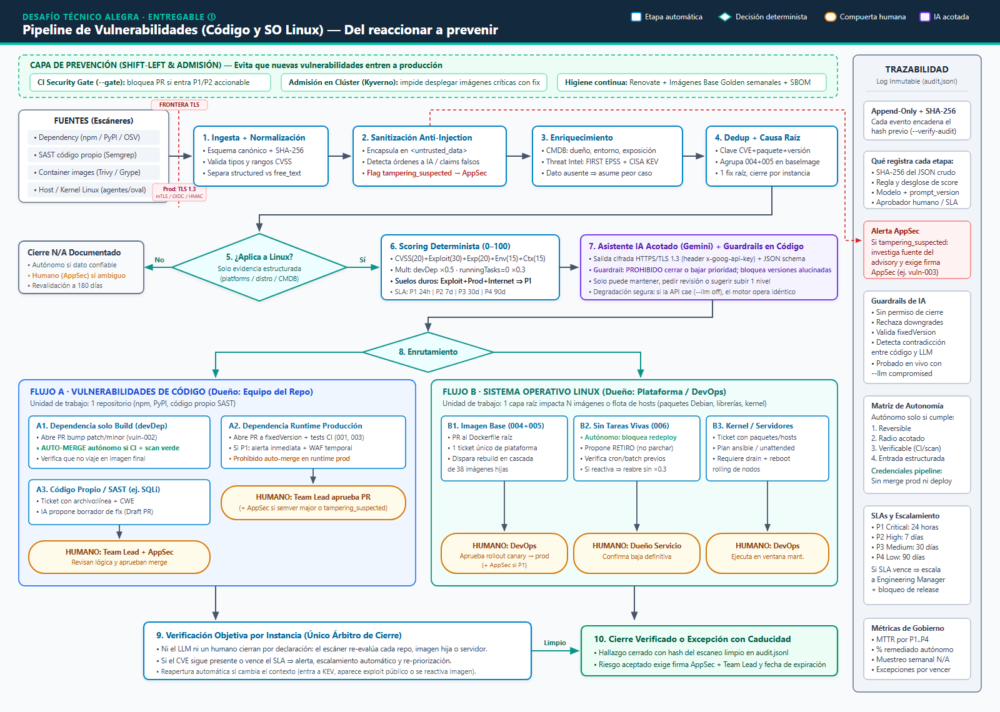
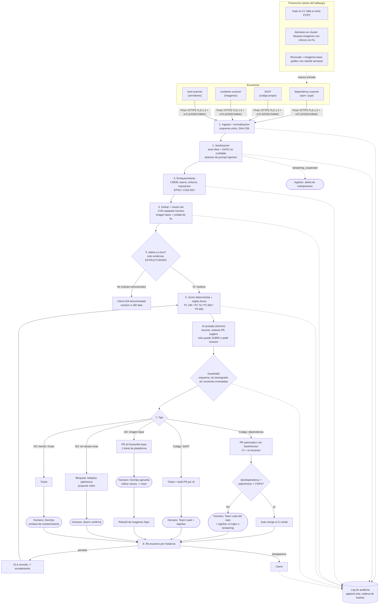

# ① Diagrama del pipeline

> Formatos listos para entrega: [PNG alta resolución](01_diagrama.png) · [SVG vectorial](01_diagrama.svg) · Fuente editable Mermaid abajo.

**Leyenda:** rectangulos = pasos automaticos · rombos = decisiones del motor · ovalos = intervencion humana.
